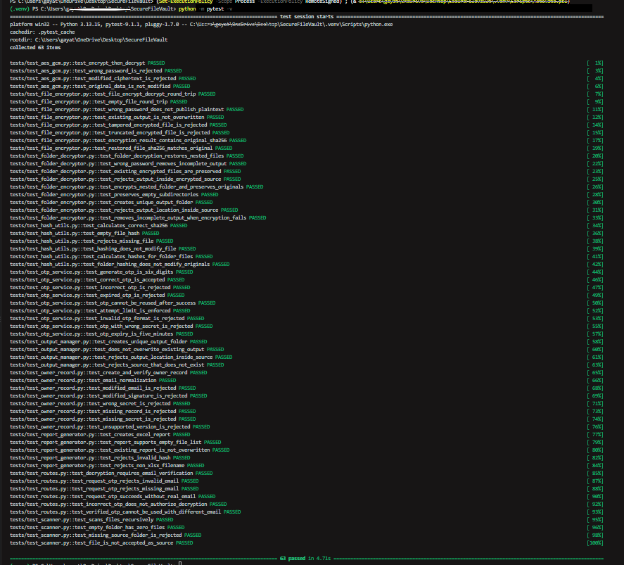
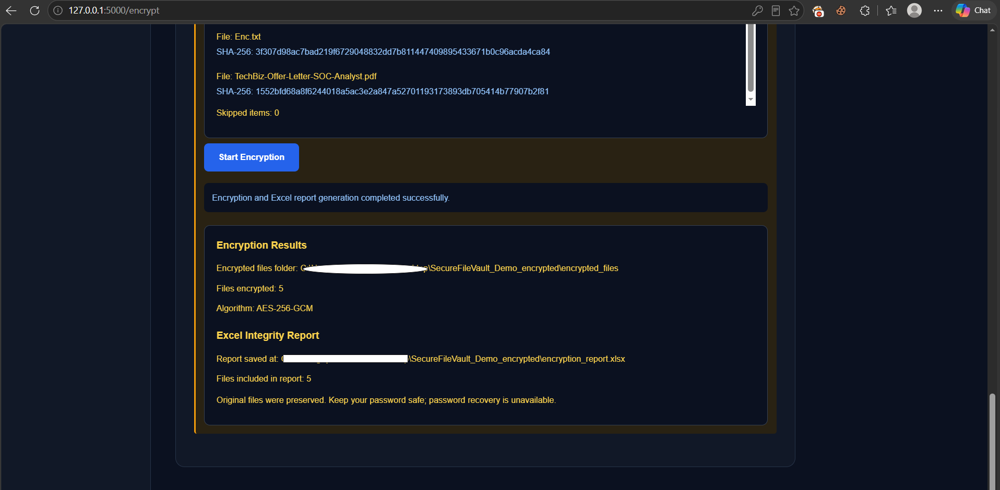
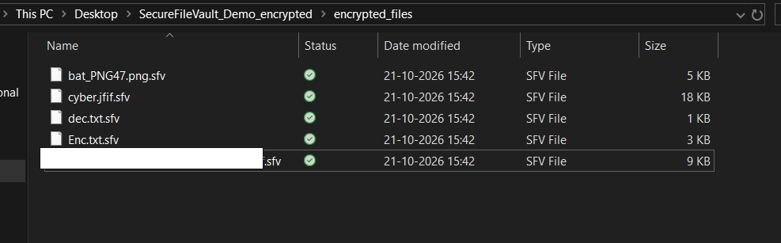
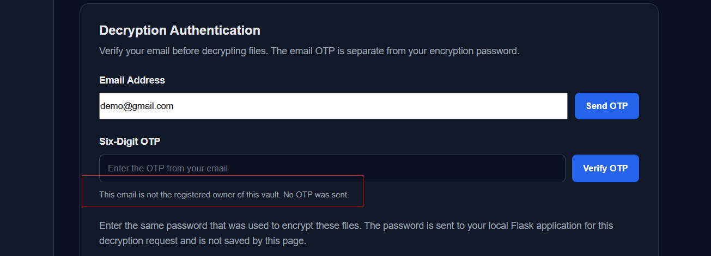
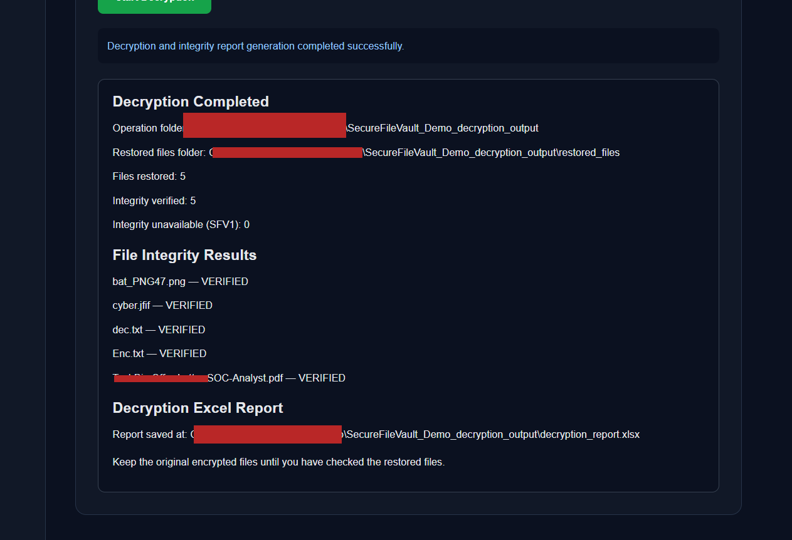
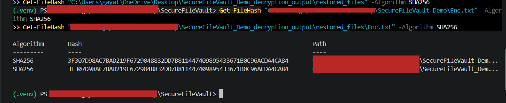
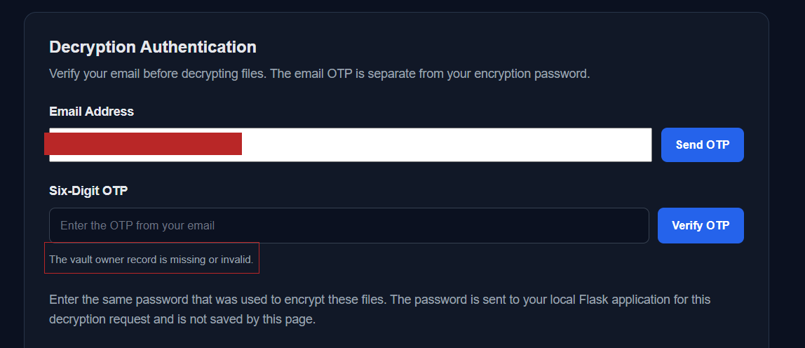

# 🔐 SecureFileVault

A local file-encryption application with authenticated encryption, email
OTP verification, and SHA-256 integrity verification.

SecureFileVault is a Python and Flask-based educational security project
designed to protect files through password-based encryption,
authenticated decryption, ownership verification, and integrity
reporting.

## ✨ Features

-   **AES-256-GCM encryption** for confidentiality and authenticated
    integrity.
-   **Password-based key derivation** using Scrypt.
-   **Recursive folder encryption** while preserving nested directory
    structures and empty directories.
-   **Authenticated chunked encryption** for file processing.
-   **Email OTP verification** for protected decryption operations.
-   **Owner verification** using a signed owner record.
-   **SHA-256 integrity checks** for original and restored files.
-   **Excel integrity reports** for encryption and decryption
    operations.
-   **Safe output handling**, including unique output folders and
    cleanup after failed operations.
-   **Automated tests** for encryption, decryption, OTP validation,
    owner verification, integrity checks, and error handling.

## 🛠️ Technology Stack

-   Python
-   Flask
-   `cryptography`
-   Scrypt
-   AES-256-GCM
-   SHA-256
-   SMTP email delivery
-   OpenPyXL
-   Pytest
-   python-dotenv

## 🏗️ Project Structure

``` text
SecureFileVault/
├── app/
│   ├── encryption/
│   ├── decryption/
│   ├── integrity/
│   ├── file_manager/
│   ├── templates/
│   ├── routes.py
│   ├── otp_service.py
│   ├── email_service.py
│   └── owner_record.py
├── tests/
├── screenshots/
├── .gitignore
├── requirements.txt
├── run.py
└── README.md
```

The `.env` file is created locally during setup and should not be
committed to Git.

## ⚙️ Installation

### 1. Clone the repository

``` bash
git clone https://github.com/gayathri-secure/SecureFileVault.git
cd SecureFileVault
```

### 2. Create and activate a virtual environment

**Windows PowerShell:**

``` powershell
python -m venv .venv
.\.venv\Scripts\Activate.ps1
```

If PowerShell blocks script activation, use Command Prompt:

``` cmd
.venv\Scripts\activate.bat
```

### 3. Install dependencies

``` powershell
python -m pip install -r requirements.txt
```

### 4. Configure email OTP (Gmail SMTP)

The email service reads `GMAIL_ADDRESS` and `GMAIL_APP_PASSWORD` from
environment variables and connects to Gmail using SMTP over SSL on port
`465`.

#### Step 1: Create a Gmail App Password

1.  Use a Gmail account you control.
2.  Open [Google Account
    Security](https://myaccount.google.com/security) and enable **2-Step
    Verification**.
3.  Open [Google App
    Passwords](https://myaccount.google.com/apppasswords).
4.  Create an App Password and copy it.

Google may not offer App Passwords for every account type or security
configuration. Use an App Password, not your normal Gmail password.

#### Step 2: Create the `.env` file

Create a file named `.env` in the project root, alongside `run.py`. Add:

``` dotenv
OTP_SECRET=replace_with_a_strong_random_secret
GMAIL_ADDRESS=your_gmail_address@gmail.com
GMAIL_APP_PASSWORD=your_16_character_app_password
```

Replace the example values with your own. Generate a strong `OTP_SECRET`
by running:

``` powershell
python -c "import secrets; print(secrets.token_hex(32))"
```

Copy the generated value into `OTP_SECRET`. Keep the `.env` file
private.

The application automatically loads the project's root `.env` file at startup using `python-dotenv`. Make sure the file contains a valid `OTP_SECRET`, `GMAIL_ADDRESS`, and `GMAIL_APP_PASSWORD`. The application will stop during startup if `OTP_SECRET` is missing. Never commit `.env` or share your credentials.

### 5. Start the application

Activate the virtual environment if it is not already active, then run:

``` powershell
python run.py
```

Open the application at http://127.0.0.1:5000.

If OTP emails are not delivered, check the Gmail address, App Password,
internet connection, spam folder, and application logs.

## 🚀 How It Works

### Encryption

1.  Select a source folder.
2.  Configure the encryption password and required owner email.
3.  Complete OTP verification when prompted by the application.
4.  Start encryption.
5.  Review the encrypted output and generated integrity report.

The application creates encrypted `.sfv` files and preserves the
original files.

### Decryption

1.  Select the vault's `encrypted_files` folder.
2.  Submit the registered owner email.
3.  Complete email OTP verification.
4.  Enter the encryption password.
5.  Select an output location and start decryption.
6.  Review the restored files and integrity results.

A wrong owner email, invalid owner record, incorrect password, or
corrupted encrypted data should cause the relevant verification or
decryption operation to fail.

## 🔒 Security Design

  -----------------------------------------------------------------------
  Component                           Purpose
  ----------------------------------- -----------------------------------
  AES-256-GCM                         Encrypts data and authenticates
                                      encrypted content

  Scrypt                              Derives an encryption key from the
                                      supplied password

  Random salt and nonce material      Supports key derivation and nonce
                                      management

  Chunk authentication                Detects unauthenticated
                                      modifications during chunked
                                      decryption

  SHA-256                             Compares file contents for
                                      integrity verification

  Email OTP                           Adds an email-based verification
                                      step

  Owner record HMAC                   Detects unauthorized owner-record
                                      modifications

  Output cleanup                      Helps prevent incomplete output
                                      from being mistaken for successful
                                      decryption
  -----------------------------------------------------------------------

### Security Notes

-   The encryption password is required for decryption and cannot be
    recovered by the application.
-   The owner record contains readable ownership metadata; it does not
    encrypt the email address.
-   Protect the `.env` file and never publish application secrets.
-   Email OTP is an additional access-control layer, not a replacement
    for encryption.
-   A compromised computer may expose local files or application
    secrets.
-   SHA-256 comparisons demonstrate content equality; they do not
    independently establish who created a file.

## 🧪 Testing

The project uses Pytest for automated testing.

Run the test suite:

``` powershell
python -m pytest -v
```

**Recorded test result:** 63 tests passed.

The test suite covers encryption and decryption, incorrect passwords,
tampering, nested folders, empty files, output handling, SHA-256
verification, OTP expiry and attempts, owner-record validation, report
generation, and application routes.

Run the suite again after making code changes to confirm the current
result.

## 📸 Screenshots

### Application Dashboard


### Automated Test Results



### Successful Folder Encryption



### Encrypted Output



### Wrong Email Rejection



### Successful Decryption



### SHA-256 Integrity Verification



### Excel Integrity Report


### Tamper Detection



## ⚠️ Limitations and Security Considerations

-   **Email configuration:** OTP delivery requires valid Gmail SMTP
    credentials or a suitably configured SMTP service.
-   **Encryption password:** Decryption requires the correct encryption
    password. Losing it may make encrypted files unrecoverable.
-   **Owner metadata:** The owner record contains readable email
    metadata. Anyone with access to the record can read it; its
    integrity protection does not encrypt its contents.
-   **OTP rate limiting:** OTP rate-limit state is maintained in
    application memory and may reset when the application restarts.
-   **Production readiness:** This project is intended for educational
    and portfolio purposes. It has not been professionally audited or
    production-hardened.

Do not use this project to protect sensitive real-world data without
further security review and hardening.

## 🎯 Learning Objectives

This project demonstrates practical implementation of:

-   Authenticated file encryption
-   Password-based cryptographic key derivation
-   Email-based verification
-   File integrity validation
-   Secure error handling
-   Automated security testing
-   Security-oriented application design

## 👩‍💻 Project Status

**Core implementation, automated tests, documentation, and GitHub
portfolio setup completed.**

SecureFileVault is an educational security project demonstrating
authenticated file encryption, email OTP verification, integrity checks,
and tamper detection.

The project has not undergone a professional security audit or
production hardening. Further security review is recommended before
considering use with sensitive real-world data.
