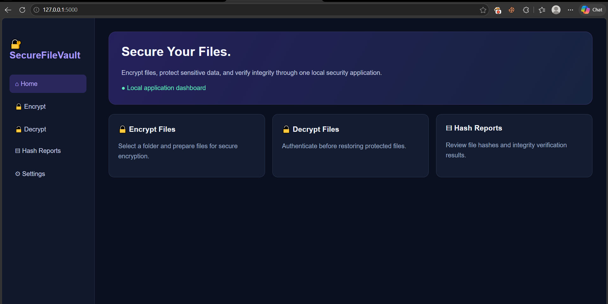
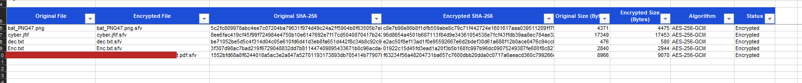

# 🔐 SecureFileVault

**A local file-encryption application with authenticated encryption, email OTP verification, and SHA-256 integrity verification.**

SecureFileVault is a Python and Flask-based security project designed to protect files through password-based encryption, authenticated decryption, ownership verification, and integrity reporting.

## ✨ Features

- **AES-256-GCM encryption** for confidentiality and authenticated integrity.
- **Password-based key derivation** using Scrypt.
- **Recursive folder encryption** while preserving nested directory structures and empty directories.
- **Authenticated chunked encryption** for file processing.
- **Email OTP verification** before protected decryption operations.
- **Owner verification** using a signed owner record.
- **SHA-256 integrity checks** for original and restored files.
- **Excel integrity reports** for encryption and decryption operations.
- **Safe output handling**, including unique output folders and cleanup after failed operations.
- **Automated tests** for encryption, decryption, OTP validation, owner verification, integrity checks, and error handling.

## 🛠️ Technology Stack

- Python
- Flask
- Cryptography
- Scrypt
- AES-256-GCM
- SHA-256
- SMTP email delivery
- OpenPyXL
- Pytest

## 🏗️ Project Structure

```text
SecureFileVault/
├── app/
│   ├── encryption/
│   ├── decryption/
│   ├── integrity/
│   ├── file_manager/
│   ├── templates/
│   ├── static/
│   ├── routes.py
│   ├── otp_service.py
│   ├── email_service.py
│   └── owner_record.py
├── tests/
├── docs/
├── screenshots/
├── .env                 # Local secrets; do not commit
├── .gitignore
├── requirements.txt
├── run.py
└── README.md
```

## ⚙️ Installation

### 1. Clone the repository

```bash
git clone <YOUR_GITHUB_REPOSITORY_URL>
cd SecureFileVault
```

Replace the placeholder with your repository URL after publishing the project.

### 2. Create a virtual environment

Windows PowerShell:

```powershell
py -m venv .venv
.\.venv\Scripts\Activate.ps1
```

### 3. Install dependencies

```powershell
python -m pip install -r requirements.txt
```

### 4. Configure environment variables

Create a local `.env` file in the project root. Configure the variables required by the application:

```dotenv
OTP_SECRET=replace_with_a_strong_random_secret
GMAIL_ADDRESS=your_sender_email@gmail.com
GMAIL_APP_PASSWORD=your_email_app_password
```

Use a strong, randomly generated secret and a provider-supported email app password. Never commit `.env` or share its values publicly.

### 5. Start the application

```powershell
python run.py
```

Open the local application in your browser:

```text
http://127.0.0.1:5000
```

## 🚀 How It Works

### Encryption

1. Select a source folder.
2. Configure the encryption password and required owner email.
3. Complete OTP verification when prompted.
4. Start encryption.
5. Review the encrypted output and generated integrity report.

The application creates encrypted `.sfv` files and preserves the original files.

### Decryption

1. Select the vault's `encrypted_files` folder.
2. Submit the registered owner email.
3. Complete email OTP verification.
4. Enter the encryption password.
5. Select an output location and start decryption.
6. Review the restored files and integrity results.

A wrong owner email, invalid owner record, incorrect password, or corrupted encrypted data should cause the relevant verification or decryption operation to fail.

## 🔒 Security Design

| Component | Purpose |
|---|---|
| AES-256-GCM | Encrypts data and authenticates encrypted content |
| Scrypt | Derives an encryption key from the supplied password |
| Random salt and nonce material | Supports secure encryption-key derivation and nonce management |
| Chunk authentication | Detects unauthenticated modifications during chunked decryption |
| SHA-256 | Compares file contents for integrity verification |
| Email OTP | Adds an email-based verification step |
| Owner record HMAC | Detects unauthorized owner-record modifications |
| Output cleanup | Helps prevent incomplete output from being mistaken for successful decryption |

### Security Notes

- The encryption password is required for decryption and cannot be recovered by the application.
- The owner record contains readable ownership metadata; it does not encrypt the email address.
- Protect the `.env` file and never publish application secrets.
- Email OTP is an additional access-control layer, not a replacement for encryption.
- A compromised computer may expose local files or application secrets.
- SHA-256 comparisons demonstrate content equality; they do not independently establish who created a file.

## 🧪 Testing

The project uses Pytest for automated testing.

Run the test suite:

```powershell
python -m pytest -v
```

**Recorded test result:** 63 tests passed.

The test suite covers encryption and decryption, incorrect passwords, tampering, nested folders, empty files, output handling, SHA-256 verification, OTP expiry and attempts, owner-record validation, report generation, and application routes.

Run the suite again after making code changes to confirm the current result.

## 📸 Project Evidence
## 📸 Screenshots

### Application Dashboard



### Automated Test Results


### Successful Folder Encryption


### Encrypted Output


### Wrong Email Rejection


### Successful Decryption


### SHA-256 Integrity Verification


### Excel Integrity Report



### Tamper Detection


## ⚠️ Limitations

- Email delivery requires valid local SMTP configuration.
- Decryption requires the correct encryption password.
- Owner metadata is readable by anyone who can access the record.
- OTP rate-limit state is maintained in application memory and may reset when the application restarts.
- This project has not been represented as professionally audited or production-hardened.

## 🎯 Learning Objectives

This project demonstrates practical implementation of:

- Authenticated file encryption
- Password-based cryptographic key derivation
- Email-based verification
- File integrity validation
- Secure error handling
- Automated security testing
- Security-oriented application design

## 👩‍💻 Project Status

**Core implementation and automated test suite completed; final documentation and portfolio review in progress.**

Further security review and production hardening may be needed before use with sensitive real-world data.
